# Shiny Phenotype Observation Network (S.P.O.N.)

## Table of contents

- [Overview](#overview)
- [Get started](#get-started)
- [Everyday commands](#everyday-commands)
- [BIOS terminal](#bios-terminal)
- [Screenshots](#screenshots)
  - [Pokédex Page](#pokédex-page)
  - [Pokémon Details](#pokémon-details)
  - [Hunt Board](#hunt-board)
  - [BIOS Theme Terminal](#bios-theme-terminal)
- [Themes](#themes)
  - [Solar Bloom](#solar-bloom)
  - [Tomorrowland](#tomorrowland)
  - [Lunar Garden](#lunar-garden)
  - [Phosphor Amber](#phosphor-amber)
  - [Orbital Relay](#orbital-relay)
  - [Rain Garden](#rain-garden)
  - [Rose Canopy](#rose-canopy)
  - [Indigo Observatory](#indigo-observatory)

## Overview

The S.P.O.N. initiative was established to document and better understand the Shiny Phenotype across known Pokémon populations. Researchers catalogue observed specimens against the National Pokédex, record Pokémon HOME storage status, and log field encounters and hunt phases through the Observation Network. The BIOS terminal provides access to the network's system interface.

## Get started

This guide starts the database, creates its tables, imports Pokémon data, and then starts the app. You’ll need Git, Docker with the Compose plugin, and an internet connection for the initial build and Pokédex import. If you use Docker Desktop, open it first. Run all commands from the repository folder.

1. **Download the project.** Clone the repository, then move into its folder:

   ```sh
   git clone https://github.com/FranciscoLMota/shiny-collection.git
   cd shiny-collection
   ```

2. **Create your local settings.** Copy the example environment file:

   ```sh
   cp .env.example .env
   ```

   In Windows PowerShell, use `Copy-Item .env.example .env` instead. Open `.env` and replace `change_me` in `POSTGRES_PASSWORD` with a password for your local database. The example username and database name can stay as they are. Keep `.env` on your computer; don’t commit it.

3. **Build the app containers.** This downloads the base images and installs the app dependencies. The first build may take a few minutes:

   ```sh
   docker compose build
   ```

4. **Start the database.** PostgreSQL stores your collection and hunt data:

   ```sh
   docker compose up -d db
   ```

   Before continuing, run `docker compose ps` and wait for the `db` service to show as `healthy`.

5. **Create the database tables.** Generate Prisma’s database client, then apply the project’s migrations:

   ```sh
   docker compose run --rm backend npx prisma generate --config prisma7.config.ts
   docker compose run --rm backend npx prisma migrate deploy --config prisma7.config.ts
   ```

6. **Import the Pokédex.** This fetches the Pokémon data the app needs from PokéAPI and saves it to the database. It can take several minutes:

   ```sh
   docker compose run --rm backend npm run import:pokemon
   ```

7. **Start the app.** Start the frontend and API services:

   ```sh
   docker compose up -d
   ```

8. **Open and verify S.P.O.N.** Visit the [app](http://localhost:5173). To check that the API is responding, open the [health endpoint](http://localhost:3000/api/health); it should report that the database is connected. If a service isn’t running, check `docker compose ps` and view the backend logs with `docker compose logs -f backend` (press Ctrl+C to stop following the logs).

## Everyday commands

Run these from the repository root.

| Command | What it does |
| --- | --- |
| `docker compose up -d` | Start the app after the initial setup |
| `docker compose down` | Stop the app and keep your collection and hunts |
| `docker compose ps` | Check which services are running |
| `docker compose logs -f backend` | Follow the API logs. Press Ctrl+C to stop following |
| `docker compose exec backend npm run import:pokemon` | Rerun the Pokédex import while the app is running |
| `docker compose exec frontend npm run build` | Type-check and build the frontend |
| `docker compose exec frontend npm run lint` | Lint the frontend |

## BIOS terminal

Click the terminal icon in the lower-left corner. Type a command and press Enter. Use the Up and Down arrows to recall commands. Your chosen theme is saved in your browser.

| Command | What it does |
| --- | --- |
| `theme list` | List themes and highlight the current one |
| `theme set indigo-observatory` | Switch themes. Use any ID from `theme list` |
| `theme current` | Show the current theme ID |
| `help` | Show available commands |
| `clear` | Clear the terminal output |

The frontend uses React, TypeScript, Vite, and Tailwind CSS. The API uses Express and Prisma with PostgreSQL.

## Screenshots

### Pokédex Page
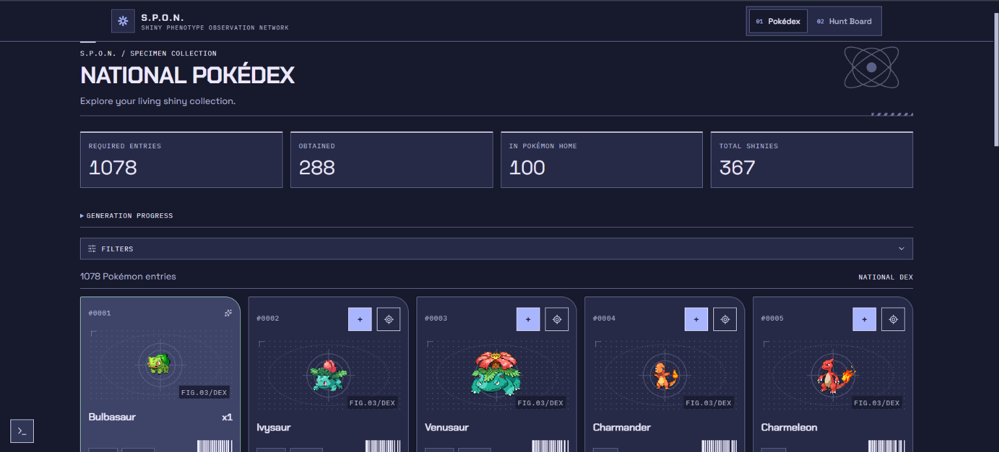

### Pokémon Details
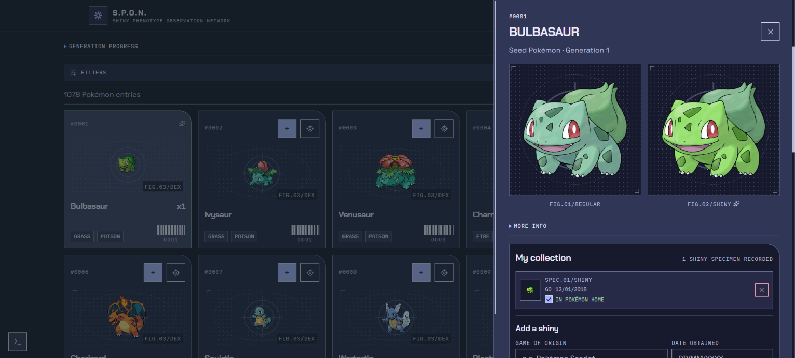

### Hunt Board
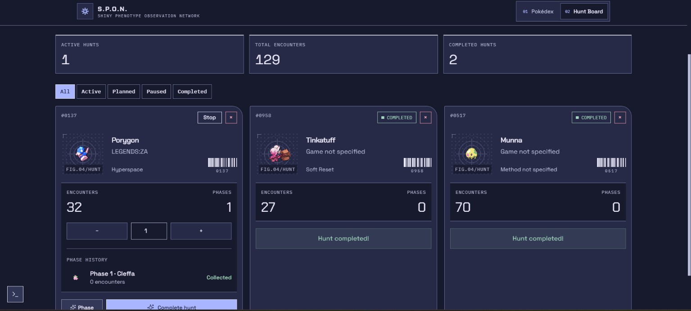

### BIOS Theme Terminal
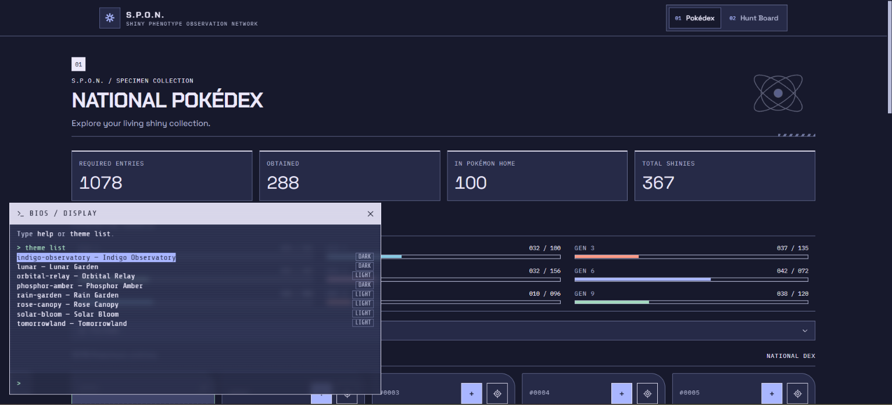

## Themes

### Solar Bloom
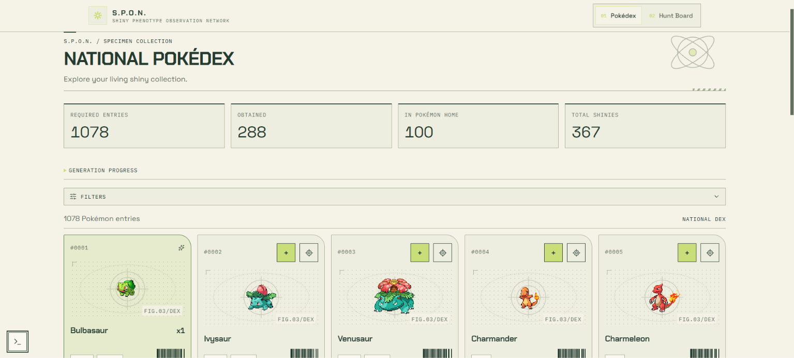

### Tomorrowland
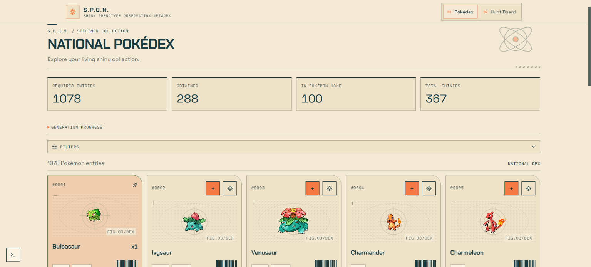

### Lunar Garden
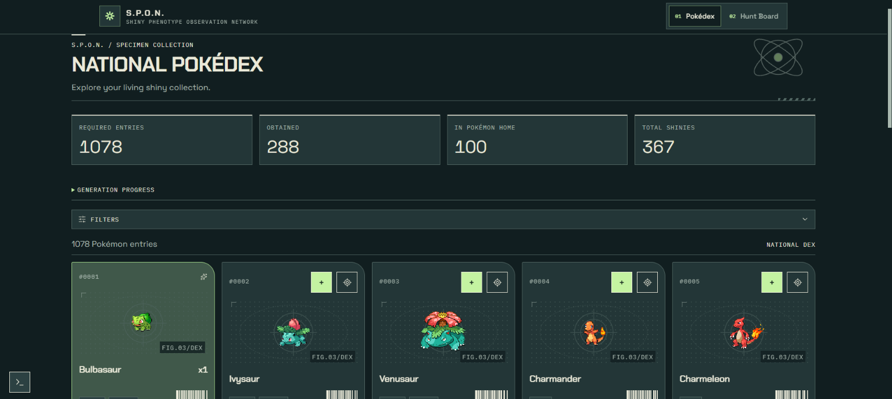

### Phosphor Amber
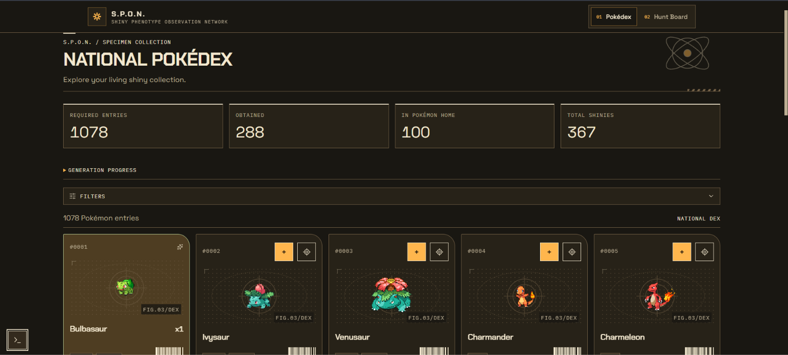

### Orbital Relay
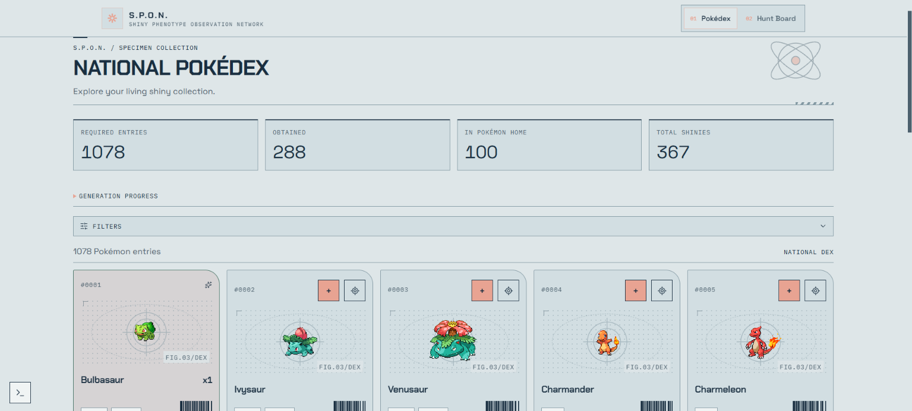

### Rain Garden
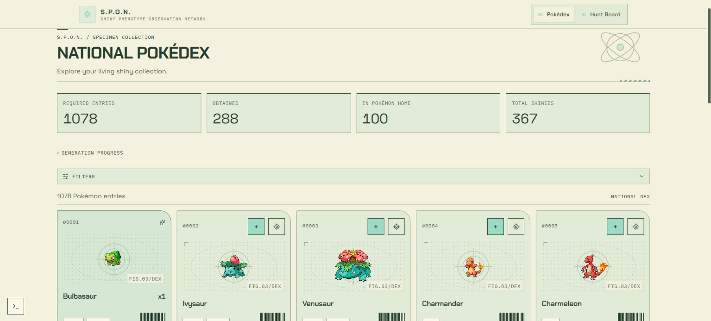

### Rose Canopy
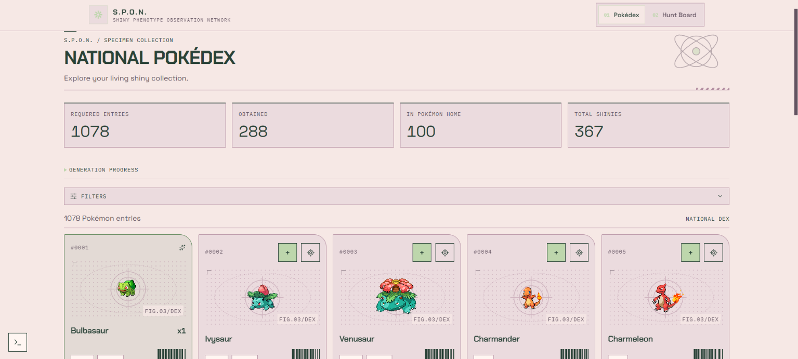

### Indigo Observatory
